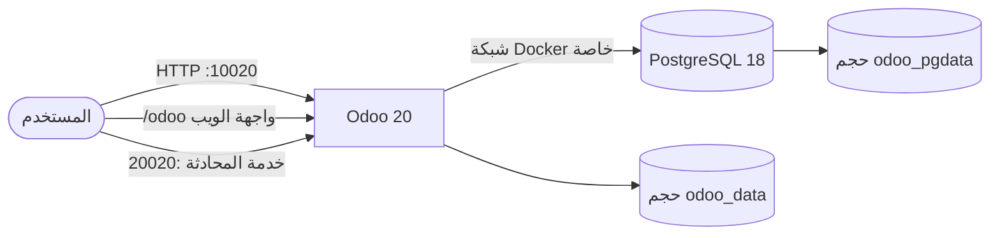
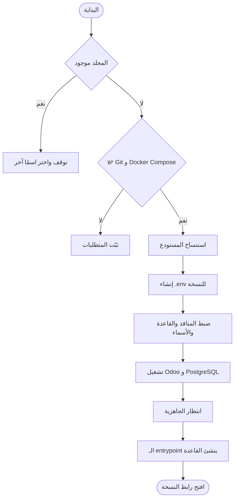
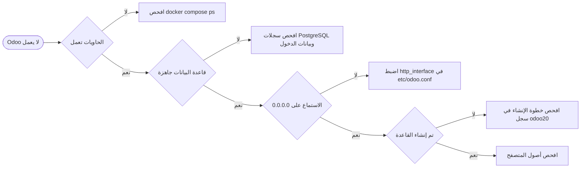

<div align="center">

# Odoo 20 · التثبيت عبر Docker

**Odoo 20 + PostgreSQL 18 · Docker Compose · Traefik اختياري**

[التثبيت السريع](#4-التثبيت-السريع) · [أكثر من نسخة](#8-أكثر-من-نسخة) · [التحديث](#9-تحديث-تثبيت-قائم) · [استكشاف الأخطاء](#15-استكشاف-الأخطاء)

</div>

---

## المحتويات

1. [نظرة عامة](#1-نظرة-عامة)
2. [المتطلبات](#2-المتطلبات)
3. [البنية](#3-البنية)
4. [التثبيت السريع](#4-التثبيت-السريع)
5. [الوصول وبيانات الدخول](#5-الوصول-وبيانات-الدخول)
6. [الإعداد](#6-الإعداد)
7. [المنافذ والروابط](#7-المنافذ-والروابط)
8. [أكثر من نسخة](#8-أكثر-من-نسخة)
9. [تحديث تثبيت قائم](#9-تحديث-تثبيت-قائم)
10. [Traefik و HTTPS](#10-traefik-و-https)
11. [إدارة الحاويات](#11-إدارة-الحاويات)
12. [النسخ الاحتياطي والاستعادة](#12-النسخ-الاحتياطي-والاستعادة)
13. [الإزالة](#13-الإزالة)
14. [ضبط الخادم والصلاحيات](#14-ضبط-الخادم-والصلاحيات)
15. [استكشاف الأخطاء](#15-استكشاف-الأخطاء)
16. [هيكل المشروع والأمان](#16-هيكل-المشروع-والأمان)
17. [روابط مفيدة](#17-روابط-مفيدة)

---

## ‏1. نظرة عامة

`docker compose up -d` تكفي لتشغيل نسخة واحدة: الحاوية تنشئ قاعدة بيانات Odoo
وتهيئها عند أول تشغيل. استخدم `run.sh` لإنشاء عدة نسخ على منافذ مختلفة، وملف
Compose اختياري للربط مع Traefik.

| المكوّن | الصورة | منفذ المضيف | تخزين البيانات |
|---|---|---|---|
| Odoo | `odoo:20` | `10020` ويب · `20020` محادثة | حجم `odoo_data` |
| PostgreSQL | `postgres:18` | غير منشور | حجم `odoo_pgdata` |

**ما يقوم به المكدس:**

| الخطوة | أين تحدث |
|---|---|
| توليد `/tmp/odoo.conf` من متغيرات البيئة | `entrypoint.sh` |
| الانتظار حتى يقبل PostgreSQL الاتصالات | `entrypoint.sh` |
| إنشاء قاعدة Odoo وتحميل `base` (أول تشغيل فقط) | `entrypoint.sh` |
| تشغيل Odoo على `0.0.0.0:8069` و`8072` | `odoo` |
| إعادة التشغيل التلقائي بعد إعادة تشغيل الخادم | `restart: always` |

> **PostgreSQL 18** نقل مجلد بياناته إلى `/var/lib/postgresql/18/docker`، والصورة
> ترفض نقطة التركيب القديمة `/var/lib/postgresql/data`. لذلك يستخدم المشروع
> الحجم المُدار `odoo_pgdata` افتراضيًا، وهذا يزيل مشاكل ملكية الملفات على
> المضيف. يوجد بديل بتركيب مجلد مضيف في
> [`docker-compose.bindmount.yml`](docker-compose.bindmount.yml).

## ‏2. المتطلبات

| المتطلب | ملاحظة |
|---|---|
| Docker Engine 24+ | `docker --version` |
| Docker Compose v2 | `docker compose version` (الإصدار v1 غير مدعوم) |
| سيرفر Linux | Ubuntu 22.04/24.04 أو Debian 12 أو أي توزيعة فيها Docker |
| Git | للتثبيت بالاستنساخ ولأجل `run.sh` |
| منافذ متاحة | `10020` و`20020` افتراضيًا (مع زوج لكل نسخة إضافية) |
| الموارد | 2 معالج و4 غيغابايت ذاكرة كحد أدنى عملي |

تثبيت Docker على Ubuntu جديد:

```bash
curl -fsSL https://get.docker.com | sudo sh
sudo usermod -aG docker "$USER"   # سجّل الخروج والدخول، أو استخدم sudo مؤقتًا
docker compose version
```

> لا تشغّل بعض الأوامر بـ `sudo` وبعضها بدونه على نفس المجلد؛ هذا سبب أخطاء
> `Permission denied` عند تعديل الملفات.

## ‏3. البنية



| الشبكة/الحجم | الاستخدام |
|---|---|
| `odoo20_internal` | شبكة داخلية بين `odoo20` و`odoo20-db` |
| `odoo_data` | مرفقات Odoo والجلسات |
| `odoo_pgdata` | بيانات PostgreSQL |

كل نسخة من `run.sh` لها شبكتها وأحجامها وأسماء حاوياتها، فلا تتشارك البيانات.

## ‏4. التثبيت السريع

ثلاثة أوامر فقط، بدون تعديل `.env` وبدون خطوة تهيئة يدوية:

```bash
git clone https://github.com/abdalazeim/InstallingOdoo20-Docker-Deployment.git
cd InstallingOdoo20-Docker-Deployment
docker compose up -d
```

عند أول تشغيل ينشئ الـ entrypoint قاعدة `odoo20`، ويحمّل `base`، ثم يشغّل
الويب. بعد ذلك افتح `http://<IP>:10020/odoo`.

### 1. تنزيل المشروع

```bash
git clone https://github.com/abdalazeim/InstallingOdoo20-Docker-Deployment.git
cd InstallingOdoo20-Docker-Deployment
```

### 2. اختياري: تغيير المنافذ وكلمات المرور

القيم الافتراضية تعمل مباشرة. لتغييرها أنشئ `.env` من القالب:

```bash
cp .env.example .env
chmod 600 .env
```

عدّل `.env` وضع كلمات مرور قوية. لا ترفع `.env` إلى Git.

### 3. التشغيل ومتابعة أول إقلاع

```bash
docker compose pull
docker compose up -d
docker compose ps
docker compose logs -f odoo20
```

أول تشغيل يستغرق من دقيقة إلى ثلاث دقائق: يبدأ PostgreSQL ثم تُنشأ القاعدة
وتُهيّأ ثم يبدأ Odoo بالخدمة. السجل يعرض كل خطوة:

```text
Initialising Odoo database odoo20 (first start only)...
...
INFO ... HTTP service ... running on http://0.0.0.0:8069
```

أوقف متابعة السجل بـ `Ctrl+C`؛ الحاوية تبقى تعمل.

### 4. التحقق

```bash
curl -I http://localhost:10020/odoo
```

الرد `200` أو إعادة توجيه إلى `/web/login`، وليس `/web/database/selector` أبدًا.
ثم افتح `http://<IP>:10020/odoo` في المتصفح.

> **بادئة Odoo 20:** انتقلت واجهة الويب من `/web` إلى `/odoo`.
> `http://الخادم:10020/` يعيد التوجيه إلى `/odoo`، و`/odoo/discuss` و
> `/odoo/sales` هي نقاط الدخول الطبيعية. المسارات `/web/login` و
> `/web/database/manager` و`/web/database/selector` ما زالت موجودة كمسارات
> خلفية قديمة. هذا سلوك Odoo المتعمد وليس خللًا في التثبيت.

> **`ODOO_DB_NAME` هو من يحدد قاعدة البيانات.** مع `list_db = False` لا يستطيع
> Odoo عرض منتقي قواعد البيانات، لذا الاسم الخاطئ أو الفارغ يُبقي `/odoo` عند
> `303 -> /web/database/selector`. الافتراضي `odoo20`؛ واختر اسمًا مختلفًا لكل
> نسخة ثم أعد التشغيل بـ `docker compose up -d`. اضبط `ODOO_AUTO_INIT=0` إن
> أردت إنشاء القواعد بنفسك عبر `odoo -i base`.

## ‏5. الوصول وبيانات الدخول

| الخدمة | العنوان |
|---|---|
| واجهة Odoo | **[http://localhost:10020/odoo](http://localhost:10020/odoo)** |
| منفذ المحادثة | **[http://localhost:20020](http://localhost:20020)** |

> المنفذ `20020` لخدمة المحادثة اللحظية (WebSocket) فقط، وليس واجهة ويب ثانية
> ولا يمكن تصفحه.

| البيان | القيمة الابتدائية | الاستخدام |
|---|---|---|
| كلمة مرور Odoo الرئيسية | `Admin@20` | عمليات إدارة قواعد البيانات |
| مستخدم PostgreSQL | `odoo20` | اتصال Odoo بقاعدة البيانات |
| كلمة مرور PostgreSQL | `odoo@20` | اتصال Odoo بقاعدة البيانات |
| قاعدة PostgreSQL الابتدائية | `postgre` | قاعدة تُنشأ عند أول تهيئة فقط |
| قاعدة Odoo | `odoo20` | تُنشأ تلقائيًا عند أول تشغيل (`ODOO_DB_NAME`) |

هذه أمثلة توضيحية **وليست أسرار إنتاج**؛ و`POSTGRES_DB` قاعدة تهيئة PostgreSQL
فقط وليست قاعدة Odoo.

## ‏6. الإعداد

### 6.1 ملف `.env` (لكل نسخة)

عدّل `.env` ولا ترفعه إلى Git؛ فهو مستثنى في `.gitignore`.

| المتغير | الافتراضي | الوظيفة |
|---|---|---|
| `ODOO_IMAGE` | `odoo:20` | صورة Odoo |
| `PG_IMAGE` | `postgres:18` | صورة PostgreSQL |
| `POSTGRES_USER` | `odoo20` | دور قاعدة البيانات |
| `POSTGRES_PASSWORD` | `odoo@20` | كلمة مرور قاعدة البيانات |
| `POSTGRES_DB` | `postgre` | قاعدة تهيئة PostgreSQL فقط |
| `ODOO_ADMIN_PASSWORD` | `Admin@20` | كلمة مرور Odoo الرئيسية |
| `ODOO_DB_NAME` | `odoo20` | قاعدة Odoo التي تخدمها هذه النسخة (`db_name`)؛ اتركها فارغة لوضع منتقي القواعد |
| `ODOO_AUTO_INIT` | `1` | إنشاء `ODOO_DB_NAME` بـ `odoo -i base` عند أول تشغيل |
| `ODOO_HTTP_PORT` | `10020` | منفذ المضيف لـ Odoo |
| `ODOO_CHAT_PORT` | `20020` | منفذ المضيف للمحادثة |
| `ODOO_NETWORK` | `odoo20_internal` | الشبكة الداخلية |
| `ODOO_CONTAINER_NAME` | `odoo20` | اسم حاوية Odoo |
| `ODOO_DB_CONTAINER_NAME` | `odoo20-db` | اسم حاوية PostgreSQL |
| `ODOO_DOMAIN` | مطلوب مع Traefik | اسم النطاق |
| `DOCKER_PROXY_NETWORK` | `proxy` | شبكة Traefik الخارجية |
| `CERTSRESOLVER` | `letsencrypt` | مزوّد إصدار الشهادات |

تطبيق التغييرات:

```bash
docker compose up -d
```

> **قاعدة موجودة:** متغيرات PostgreSQL تُطبَّق عند أول تهيئة فقط. تغيير كلمات
> المرور في `.env` لا يغيّر بيانات موجودة، وتغيير `ODOO_DB_NAME` لا يعيد تسمية
> قاعدة موجودة بل يغيّر القاعدة التي يخدمها Odoo فقط.

### 6.2 كيف يقرأ Compose الملفات

| الحالة | النتيجة |
|---|---|
| `docker compose up -d` داخل مجلد المشروع | يقرأ `.env` من ذلك المجلد |
| `docker compose --project-directory odoo-live -f odoo-live/docker-compose.yml up -d` | يقرأ `.env` من `odoo-live/` |
| `ODOO_HTTP_PORT=15000 docker compose up -d` | متغير الصدفة يتقدم على `.env` |
| لا يوجد `.env` | يستخدم الافتراضيات في الجدول أعلاه |

تحقق من النتيجة قبل التشغيل:

```bash
docker compose config
```

### 6.3 ملف `etc/odoo.conf` (إعدادات Odoo)

الملف المتابع قالب فقط؛ يقوم `entrypoint.sh` بتوليد `/tmp/odoo.conf` عند كل
تشغيل ويستبدل عناصر `${...}` من بيئة الحاوية. لا تضع أسرارًا في الملف المتابع.

| الخيار | القيمة | السبب |
|---|---|---|
| `admin_passwd` | `${ODOO_ADMIN_PASSWORD}` | كلمة مرور إدارة قواعد البيانات |
| `db_host` / `db_port` | `db` / `5432` | خدمة PostgreSQL على الشبكة الداخلية |
| `db_user` / `db_password` | `${ODOO_DB_USER}` / `${ODOO_DB_PASSWORD}` | بيانات الدخول |
| `db_name` | `${ODOO_DB_NAME}` | وضع قاعدة واحدة؛ يُحذف السطر إذا كانت القيمة فارغة |
| `addons_path` | مسارات النواة + `/mnt/extra-addons` | إضافات Odoo |
| `data_dir` | `/var/lib/odoo` | المخزن داخل حجم `odoo_data` |
| `list_db` | `False` | تعطيل صفحة إدارة قواعد البيانات |
| `proxy_mode` | `True` | الثقة برؤوس `X-Forwarded-*` من الوكيل العكسي |
| `http_interface` | `0.0.0.0` | بدونها يستمع Odoo على `127.0.0.1` ولا تعمل المنافذ المنشورة |
| `workers` | `3` | عدد العمليات؛ زدها مع زيادة المعالجات |
| `limit_*` | حدود الذاكرة والمعالجة والطلبات | منع إشباع الخادم |
| `log_level` / `log_handler` | `info` / `:INFO` | مستوى السجلات |

### 6.4 الإضافات وحزم Python

- إضافات Odoo: [`addons/`](addons/) مثبّتة على `/mnt/extra-addons`.
- حزم إضافية: [`etc/requirements.txt`](etc/requirements.txt)، وهي تعليقات فقط
  افتراضيًا فلا تُثبَّت أي حزمة. عند إضافة حزم تُثبَّت بـ `pip3` عند كل تشغيل.

> مجلد `/mnt/extra-addons` فارغ افتراضيًا، لذا يسجّل Odoo تحذيرًا
> `invalid addons directory '/mnt/extra-addons', skipped`؛ وهو تحذير غير مؤثر.

### 6.5 اختياري: تخزين بيانات PostgreSQL على المضيف

الملف `docker-compose.bindmount.yml` يضع البيانات في `./postgresql` بدل الحجم
المُدار:

```bash
sudo rm -rf postgresql
sudo mkdir -p postgresql
sudo chmod 700 postgresql
docker compose -f docker-compose.bindmount.yml up -d
```

> يجب إنشاء المجلد بـ `sudo`. إذا كان مملوكًا لمستخدم آخر فقد تفشل الحاوية بـ
> `mkdir: cannot create directory '/var/lib/postgresql': Permission denied`.

## ‏7. المنافذ والروابط

| النشر | النمط | منفذ Odoo | خدمة المحادثة | الرابط |
|---|---|---|---|---|
| `docker-compose.yml` | منافذ مباشرة | `10020` → `8069` | `20020` → `8072` | `http://<الخادم>:10020/odoo` |
| `docker-compose.bindmount.yml` | منافذ مباشرة | `10020` → `8069` | `20020` → `8072` | `http://<الخادم>:10020/odoo` |
| `docker-compose.traefik.yml` | وكيل عكسي | غير منشور | غير منشور | `https://<ODOO_DOMAIN>/odoo` |
| نسخة `run.sh` | منافذ مباشرة | `--port` → `8069` | `--chat` → `8072` | `http://<الخادم>:<المنفذ>/odoo` |

- منفذ الويب فقط يعرض واجهة؛ منفذ المحادثة لا يعرض شيئًا في المتصفح.
- واجهة Odoo 20 تحت `/odoo`، و`/` يعيد التوجيه إليها.
- PostgreSQL غير منشور؛ استخدم `docker compose exec db psql`.
- نسختان على نفس الخادم تحتاجان منافذ مختلفة، وإلا فشل التثبيت الثاني بـ
  `Bind for 0.0.0.0:10020 failed: port is already allocated`.

فتح المنافذ في جدار الحماية:

```bash
sudo ufw allow 10020/tcp
sudo ufw allow 20020/tcp
```

## ‏8. أكثر من نسخة

ينسخ `run.sh` المستودع إلى **مجلد جديد**، ويضبط منافذ واسم قاعدة وأسماء حاويات
وشبكة خاصة بكل نسخة، ثم ينتظر جاهزية PostgreSQL و Odoo. الحاوية تنشئ قاعدة Odoo
عند أول تشغيل، لذا ينتهي التثبيت بنسخة جاهزة. لن يستبدل مجلدًا موجودًا.



**المتطلبات:** Git و Docker Engine و Docker Compose v2 وصلاحية تشغيل Docker.
نفّذ من جذر المستودع:

```bash
# النسخة الأولى
sudo bash run.sh --destination odoo-live --port 10020 --chat 20020

# النسخة الثانية
sudo bash run.sh --destination odoo-test --port 11020 --chat 21020 --db odoo_test
```

| الخيار | الوظيفة |
|---|---|
| `--destination` | مجلد النسخة (إلزامي) |
| `--port` | منفذ Odoo على المضيف (إلزامي) |
| `--chat` | منفذ المحادثة (إلزامي) |
| `--db` | اسم قاعدة Odoo (افتراضي `odoo<port>`) |
| `--skip-init` | ضبط `ODOO_AUTO_INIT=0` لعدم إنشاء قاعدة Odoo تلقائيًا |
| `-h` / `--help` | عرض المساعدة |

| النسخة | المجلد | رابط Odoo | منفذ المحادثة |
|---|---|---|---|
| `odoo-live` | `odoo-live/` | `http://localhost:10020/odoo` | `20020` |
| `odoo-test` | `odoo-test/` | `http://localhost:11020/odoo` | `21020` |

لكل نسخة حجم PostgreSQL وحجم بيانات مستقلان. أدرها من مجلدها:

```bash
cd odoo-live
docker compose ps
docker compose logs -f
```

> **ملكية الملفات.** يشغّل `run.sh` عملية `git clone` كـ root ثم يعيد ملكية
> المجلد للمستخدم الذي شغّل الأمر. إذا كانت نسخة قديمة تحتفظ بملفات مملوكة لـ
> root فإن تعديل `.env` أو `etc/odoo.conf` يفشل بـ
> `sed: couldn't open temporary file ... Permission denied`. أصلحها مرة واحدة:
>
> ```bash
> sudo chown -R "$USER":"$USER" odoo-live
> ```
>
> استخدم `sudo` فقط عند الحاجة الفعلية؛ تشغيل المثبّت بـ `sudo` ثم تعديل
> الملفات بدون `sudo` هو سبب الخطأ.

## ‏9. تحديث تثبيت قائم

اختر المسار المطابق لطريقة إنشاء المجلد.

### 9.1 منسوخ بـ Git (ومنها كل نسخ `run.sh`)

```bash
cd /opt/Odoo20-Deployment
git pull --ff-only
docker compose up -d --force-recreate odoo20
docker compose logs -f odoo20
```

### 9.2 منزّل بـ curl (بدون تاريخ Git)

```bash
cd /opt/Odoo20-Deployment
BASE=https://raw.githubusercontent.com/abdalazeim/InstallingOdoo20-Docker-Deployment/main

for f in docker-compose.yml entrypoint.sh etc/odoo.conf .env.example; do
  curl -fsSL -o "$f" "$BASE/$f"
done

docker compose up -d --force-recreate odoo20
```

### 9.3 متغيرات جديدة في `.env`

أضف الناقص دون تعديل الباقي:

```bash
for f in .env odoo-live/.env odoo-test/.env; do
  grep -q '^ODOO_DB_NAME='  "$f" || echo 'ODOO_DB_NAME=odoo20'  >> "$f"
  grep -q '^ODOO_AUTO_INIT=' "$f" || echo 'ODOO_AUTO_INIT=1'    >> "$f"
done
```

ثم اضبط اسمًا مختلفًا لكل نسخة وأعد الإنشاء:

```bash
sed -i 's/^ODOO_DB_NAME=.*/ODOO_DB_NAME=odoo20/'    .env
sed -i 's/^ODOO_DB_NAME=.*/ODOO_DB_NAME=odoo_live/' odoo-live/.env
sed -i 's/^ODOO_DB_NAME=.*/ODOO_DB_NAME=odoo_test/' odoo-test/.env

docker compose up -d --force-recreate odoo20
docker compose --project-directory odoo-live -f odoo-live/docker-compose.yml up -d --force-recreate odoo20
docker compose --project-directory odoo-test -f odoo-test/docker-compose.yml up -d --force-recreate odoo20
```

> `--force-recreate` ضرورية لأن التغيير في `.env`؛ بدونها قد يعتبر Compose الحاوية
> محدّثة فلا يقرأ المتغيرات الجديدة. حجم قاعدة البيانات لا يتأثر.

### 9.4 تغيير الإصدار الرئيسي لـ PostgreSQL

لا يتم بالتحديث المباشر. خذ نسخة احتياطية (القسم 12)، ثم غيّر `PG_IMAGE`، وشغّل
مع `ODOO_AUTO_INIT=0`، واستعد البيانات في العنقود الجديد.

## ‏10. Traefik و HTTPS

استخدم `docker-compose.traefik.yml` فقط إذا كان Traefik يعمل وشبكته موجودة.

```dotenv
ODOO_DOMAIN=odoo.example.com
DOCKER_PROXY_NETWORK=proxy
CERTSRESOLVER=letsencrypt
```

```bash
docker network create proxy   # إن لم تكن موجودة
docker compose -f docker-compose.traefik.yml up -d
```

اضبط DNS وentrypoint وجهة إصدار الشهادات في Traefik ثم افتح
`https://odoo.example.com`. لا تشغّل وضع المنافذ المباشرة ووضع Traefik للنسخة
نفسها في الوقت نفسه.

| تسمية Traefik | الأثر |
|---|---|
| `routers.odoo20` | توجيه `Host(ODOO_DOMAIN)` إلى Odoo على `8069` |
| `routers.odoo20-websocket` | توجيه `/websocket` إلى Odoo على `8072` بأولوية أعلى |
| `tls.certresolver` | إصدار الشهادة وتجديدها |

`proxy_mode = True` في `etc/odoo.conf` مطلوب في هذا الوضع، وإلا بنى Odoo روابط
خاطئة ورفض الطلبات القادمة من الوكيل.

## ‏11. إدارة الحاويات

| العملية | الأمر |
|---|---|
| تشغيل | `docker compose up -d` |
| إعادة إنشاء خدمة | `docker compose up -d --force-recreate odoo20` |
| الحالة | `docker compose ps` |
| السجلات | `docker compose logs -f` |
| سجلات Odoo | `docker compose logs -f odoo20` |
| سجلات PostgreSQL | `docker compose logs -f db` |
| فحص الإعداد المدموج | `docker compose config` |
| إعادة تشغيل | `docker compose restart` |
| إيقاف مع حفظ البيانات | `docker compose down` |
| الدخول إلى PostgreSQL | `docker compose exec db psql -U odoo20 -d postgre` |
| فحص جاهزية PostgreSQL | `docker compose exec db pg_isready -U odoo20 -d postgre` |

كل الخدمات تستخدم `restart: always`. تجنب `docker compose down -v` لأنه يحذف
حجم قاعدة البيانات.

فحوص إضافية:

```bash
docker compose ps --format 'table {{.Name}}\t{{.Status}}\t{{.Ports}}'
docker inspect -f '{{.State.Health.Status}}' odoo20-db
```

## ‏12. النسخ الاحتياطي والاستعادة

```bash
mkdir -p backups

# قاعدة البيانات (صيغة مضغوطة مناسبة لـ pg_restore)
docker compose exec -T db pg_dump -U odoo20 -d odoo20 -Fc > backups/odoo20.dump

# المخزن والجلسات
docker compose exec -T odoo20 tar -C /var/lib/odoo -czf - . > backups/odoo-data.tar.gz
```

استخدم أسماء الحاويات الظاهرة في `docker compose ps` عند العمل مع نسخة من
`run.sh`.

### الاستعادة

```bash
# 1. أوقف Odoo حتى لا يكتب أحد على القاعدة
docker compose stop odoo20

# 2. استعد قاعدة البيانات فوق الحالية
docker compose exec -T db pg_restore -U odoo20 -d odoo20 --clean --if-exists < backups/odoo20.dump

# 3. استعد المخزن
docker compose exec -T odoo20 tar -C /var/lib/odoo -xzf - < backups/odoo-data.tar.gz

# 4. أعد التشغيل
docker compose start odoo20
```

للاستعادة في قاعدة جديدة:

```bash
docker compose exec -T db psql -U odoo20 -d postgre -c 'CREATE DATABASE odoo20 OWNER odoo20;'
```

احمِ ملفات النسخ؛ فـ SQL قد يحتوي كلمات مرور وبيانات عمل. احتفظ بنسخة خارج
الخادم واختبر الاستعادة دوريًا.

## ‏13. الإزالة

```bash
# إيقاف وإزالة الحاويات والشبكة مع حفظ البيانات
docker compose down

# إزالة الحاويات والشبكة والحجمين (لا رجعة فيه)
docker compose down -v

# إزالة مجلد المشروع
cd ..
rm -rf InstallingOdoo20-Docker-Deployment
```

لنسخة من `run.sh` كرّر الأوامر داخل مجلدها (`odoo-live/`، `odoo-test/`)؛ فكل
نسخة لها أحجامها الخاصة.

## ‏14. ضبط الخادم والصلاحيات

### صلاحيات الملفات

لا تستخدم `chmod -R 777`؛ فهي تمنح كل مستخدم محلي صلاحية كاملة. استخدم صلاحيات
مقيّدة:

```bash
chmod 600 .env
```

مع التركيب على مجلد مضيف أنشئ المجلد بـ `sudo`:

```bash
sudo mkdir -p postgresql
sudo chmod 700 postgresql
```

عند خطأ صلاحية افحص المسار والسجلات قبل تغيير الملكية:

```bash
docker compose logs --tail=100
ls -ld addons etc postgresql
```

### اختياري: زيادة مراقبات inotify

```bash
if grep -qF "fs.inotify.max_user_watches" /etc/sysctl.conf; then
  grep -F "fs.inotify.max_user_watches" /etc/sysctl.conf
else
  echo "fs.inotify.max_user_watches = 524288" | sudo tee -a /etc/sysctl.conf
fi

sudo sysctl -p
```

## ‏15. استكشاف الأخطاء

### 15.1 جدول الأعراض

| المشكلة | الإجراء |
|---|---|
| المنفذ مستخدم | غيّر `ODOO_HTTP_PORT` أو `ODOO_CHAT_PORT` في `.env` ثم `docker compose up -d` |
| Odoo لا يتصل بقاعدة البيانات | `docker compose logs db odoo20` |
| فحص جاهزية PostgreSQL | `docker compose exec db pg_isready -U odoo20 -d postgre` |
| `curl` يعيد الاتصال والسجل يقول `HTTP service running on 127.0.0.1:8069` | أضف `http_interface = 0.0.0.0` إلى `etc/odoo.conf` ثم أعد التشغيل |
| `500` على صفحة الدخول مع `Database <db> not initialized` | ما زال أول تشغيل يُهيّئ القاعدة (تابع `docker compose logs -f odoo20`)، أو أن `ODOO_AUTO_INIT=0`. أنشئها بـ `odoo -c /tmp/odoo.conf -d <db> -i base --stop-after-init` |
| `303 -> /web/database/selector` على كل الروابط | `ODOO_DB_NAME` فارغ أو لا يطابق قاعدة مهيأة. اضبطه في `.env` ثم `docker compose up -d --force-recreate odoo20` |
| `Initialising Odoo database ...` لا ينتهي | افحص `docker compose logs db`؛ يجب أن يكون PostgreSQL سليمًا قبل إنشاء القاعدة |
| `exec: "/entrypoint.sh": permission denied` | أعد إنشاء الحاوية؛ ملفات compose تشغّل entrypoint عبر `["/bin/sh", "/entrypoint.sh"]` |
| `Unknown command 'odoo'` من `docker compose run` | لا تُمرّر أمرًا يبدأ بـ `odoo`؛ الـ entrypoint يضيفه تلقائيًا |
| `/` يعيد التوجيه و`/odoo/...` يعمل | سلوك Odoo 20 الطبيعي: انتقلت الواجهة من `/web` إلى `/odoo`. افتح `http://الخادم:10020/odoo` |
| `http://الخادم:20020/` لا يعرض شيئًا | المنفذ `20020` لخدمة WebSocket فقط وليس واجهة ويب. استخدم `10020` |
| نسخة تعمل على منفذ ولا تعمل على آخر | كل نسخة لها منافذها وأحجامها واسم قاعدتها. شغّلها من مجلدها ليقرأ `.env` الخاص بها |
| `mkdir: cannot create directory '/var/lib/postgresql'` | احذف `postgresql/` بـ `sudo` وأنشئه بـ `sudo` (أو استخدم الحجم المُدار) |
| `PostgreSQL data in /var/lib/postgresql/data (unused mount/volume)` | استخدم `PGDATA=/var/lib/postgresql/18/docker` والتركيب على `/var/lib/postgresql` |
| `Address already in use` أثناء التهيئة | الحاوية تعمل بالفعل؛ لا تشغّل `odoo` يدويًا داخلها. أعد التشغيل فقط |
| `sed: couldn't open temporary file ... Permission denied` | المجلد مملوك لـ root. نفّذ `sudo chown -R "$USER":"$USER" <المجلد>` ثم عدّل بدون `sudo` |
| خطأ عميل `odoo.loader.modules.get(...) is undefined` | امسح ذاكرة أصول المتصفح (hard reload)، ثم أعد بناء الأصول: `docker compose run --rm --no-deps odoo20 -c /tmp/odoo.conf -d <db> --stop-after-init` |
| كلمات المرور تغيّرت بلا أثر | بيانات PostgreSQL الحالية لا تُعاد تهيئتها من `.env` |
| مسار Traefik لا يعمل | افحص DNS والشبكة الخارجية وجهة الشهادات و`ODOO_DOMAIN` |

### 15.2 مسار التشخيص



### 15.3 جمع المعلومات

```bash
docker compose ps
docker compose logs --tail=200 odoo20
docker compose logs --tail=200 db
docker inspect -f '{{json .State.Health}}' odoo20-db
docker compose config
```

الإعداد الذي تستخدمه الحاوية فعليًا:

```bash
docker compose exec odoo20 cat /tmp/odoo.conf
```

## ‏16. هيكل المشروع والأمان

```text
InstallingOdoo20-Docker-Deployment/
├── addons/                          # إضافات Odoo المخصصة
├── etc/
│   ├── odoo.conf                    # قالب إعداد Odoo
│   └── requirements.txt             # حزم Python اختيارية
├── postgresql/                      # بيانات PostgreSQL (bind mount اختياري)
├── .env.example                     # قالب متغيرات البيئة
├── docker-compose.yml               # نشر مباشر (حجم مُدار)
├── docker-compose.bindmount.yml     # نشر مباشر (مجلد مضيف)
├── docker-compose.traefik.yml       # نشر عبر Traefik
├── entrypoint.sh                    # توليد الإعداد، انتظار PostgreSQL، إنشاء القاعدة
├── run.sh                           # مثبّت النسخ المتعددة
└── README.md
```

**قائمة أمان سريعة:**

- غيّر كلمات مرور Odoo و PostgreSQL الافتراضية.
- لا ترفع `.env` أو بيانات قواعد البيانات أو النسخ الاحتياطية إلى Git.
- لا تنشر منفذ PostgreSQL.
- استخدم HTTPS عبر وكيل عكسي موثوق عند النشر العام.
- حدّث صور Docker والخادم بانتظام.
- احصر صلاحية `addons/` و`etc/` على حساب الخدمة.

## ‏17. روابط مفيدة

- [توثيق Odoo 20](https://www.odoo.com/documentation/20.0/)
- [توثيق Docker Compose](https://docs.docker.com/compose/)
- [ملاحظة PGDATA في صور PostgreSQL](https://github.com/docker-library/postgres/pull/1259)
- [مستودع GitHub](https://github.com/abdalazeim/InstallingOdoo20-Docker-Deployment)
- [الإبلاغ عن مشكلة](https://github.com/abdalazeim/InstallingOdoo20-Docker-Deployment/issues)