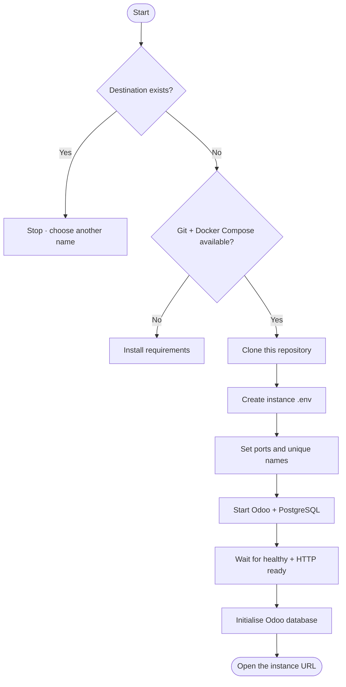
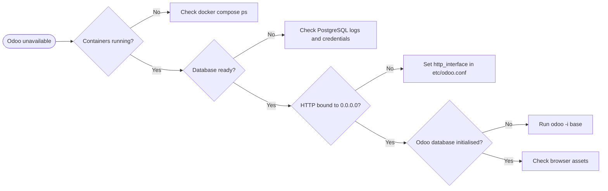

<div align="center">

# Odoo 20 · Docker Deployment

**Odoo 20 + PostgreSQL 18 · Docker Compose · Optional Traefik**

[](https://www.odoo.com/)
[](https://www.postgresql.org/)
[](https://docs.docker.com/compose/)

[Quick Start](#4-quick-start) · [Multiple Instances](#7-multiple-instances) · [Operations](#9-container-management) · [Troubleshooting](#12-troubleshooting)

</div>

---

## Contents

1. [Overview](#1-overview)
2. [Requirements](#2-requirements)
3. [Architecture](#3-architecture)
4. [Quick Start](#4-quick-start)
5. [Access and Initial Credentials](#5-access-and-initial-credentials)
6. [Configuration](#6-configuration)
7. [Multiple Instances](#7-multiple-instances)
8. [Traefik / HTTPS](#8-traefik--https)
9. [Container Management](#9-container-management)
10. [Backups](#10-backups)
11. [Linux Host Tuning and Permissions](#11-linux-host-tuning-and-permissions)
12. [Troubleshooting](#12-troubleshooting)
13. [Project Layout and Security](#13-project-layout-and-security)
14. [References](#14-references)

---

## 1. Overview

Run Odoo 20 and PostgreSQL 18 with Docker Compose. Use the standard setup for
one instance, or `run.sh` to install separate instances on different ports and
initialise their Odoo database automatically. An optional Compose file connects
Odoo to an existing Traefik network.

| Component | Image | Host access | Persistent storage |
|---|---|---|---|
| Odoo | `odoo:20` | `10020` HTTP · `20020` live service | `odoo_data` volume |
| PostgreSQL | `postgres:18` | Not published | `odoo_pgdata` volume |

> **PostgreSQL 18** moved its data directory to
> `/var/lib/postgresql/18/docker`. The historical
> `/var/lib/postgresql/data` mount point is rejected by the image. This project
> therefore uses a Docker-managed volume (`odoo_pgdata`) by default, which also
> removes host file-ownership problems.

## 2. Requirements

- Docker Engine.
- Docker Compose v2 (`docker compose`).
- Ubuntu/Linux server; Windows users can use WSL 2 with Docker integration.

## 3. Architecture


PostgreSQL is not published to the host. In Traefik mode, requests reach Odoo
through the configured reverse proxy instead of host-published ports.

## 4. Quick Start

### 1 · Get the project

```bash
git clone https://github.com/abdalazeim/InstallingOdoo20-Docker-Deployment.git
cd InstallingOdoo20-Docker-Deployment
```

### 2 · Set environment

```bash
cp .env.example .env
chmod 600 .env
chmod +x entrypoint.sh
```

Edit `.env` and replace the example passwords before exposing the service.

### 3 · Start

```bash
docker compose pull
docker compose up -d
docker compose ps
```

### 4 · Initialise the Odoo database

The `postgre` database created by the PostgreSQL image is **not** an Odoo
database. Until an Odoo database exists, the login page returns `500`:

```bash
docker compose exec -T odoo20 odoo -c /tmp/odoo.conf -d odoo20 -i base \
  --stop-after-init --without-demo=all
docker compose restart odoo20
```

### 5 · Verify

```bash
curl -I http://localhost:10020/odoo
# Expected: HTTP/1.1 303 SEE OTHER -> location: /odoo/odoo
```

Then open `http://<server-ip>:10020/odoo`.

> **Odoo 20 URL prefix:** the web client moved from `/web` to `/odoo`.
> `http://server:10020/` redirects to `/odoo`, and `/odoo/discuss`,
> `/odoo/sales` etc. are the normal entry points. `/web/login`,
> `/web/database/manager` and `/web/database/selector` still exist as legacy
> backend routes. This is intentional Odoo behaviour, not a deployment fault.

## 5. Access and Initial Credentials

| Service | Address |
|---|---|
| Odoo web interface | **[http://localhost:10020/odoo](http://localhost:10020/odoo)** |
| Live communication port | **[http://localhost:20020](http://localhost:20020)** |

> Port `20020` is the live communication/WebSocket service, not a second Odoo
> web interface. It is not a browsable Odoo UI.

| Credential | Initial value | Used for |
|---|---|---|
| Odoo master password | `Admin@20` | Odoo database-management operations |
| PostgreSQL user | `odoo20` | Odoo-to-PostgreSQL connection |
| PostgreSQL password | `odoo@20` | Odoo-to-PostgreSQL connection |
| Initial PostgreSQL database | `postgre` | PostgreSQL image initialization only |
| Odoo database created by `run.sh` | `odoo<port>` | The actual Odoo database |

These are example credentials, **not production secrets**. `POSTGRES_DB` is the
PostgreSQL bootstrap database, not an Odoo database.

## 6. Configuration

Edit `.env`; do not commit it. The file is already excluded by `.gitignore`.

| Variable | Default | Purpose |
|---|---|---|
| `ODOO_IMAGE` | `odoo:20` | Odoo image |
| `PG_IMAGE` | `postgres:18` | PostgreSQL image |
| `POSTGRES_USER` | `odoo20` | PostgreSQL role |
| `POSTGRES_PASSWORD` | `odoo@20` | PostgreSQL role password |
| `POSTGRES_DB` | `postgre` | PostgreSQL bootstrap database only |
| `ODOO_ADMIN_PASSWORD` | `Admin@20` | Odoo master password |
| `ODOO_HTTP_PORT` | `10020` | Host port → Odoo `8069` |
| `ODOO_CHAT_PORT` | `20020` | Host port → Odoo `8072` |
| `ODOO_NETWORK` | `odoo20_internal` | Private Docker network |
| `ODOO_CONTAINER_NAME` | `odoo20` | Odoo container name |
| `ODOO_DB_CONTAINER_NAME` | `odoo20-db` | PostgreSQL container name |
| `ODOO_DOMAIN` | Required for Traefik | Public hostname |
| `DOCKER_PROXY_NETWORK` | `proxy` | Existing Traefik network |
| `CERTSRESOLVER` | `letsencrypt` | Traefik certificate resolver |

Apply changes:

```bash
docker compose up -d
```

> **Existing database:** PostgreSQL initialization variables apply only when the
> data directory is first initialized. Editing credentials in `.env` does not
> change roles, passwords, or databases in existing data.

Custom addons go in [`addons/`](addons/). Odoo settings are in
[`etc/odoo.conf`](etc/odoo.conf); runtime secrets are rendered from the
container environment and should not be added to that tracked file.

### Optional · PostgreSQL data on the host

Use [`docker-compose.bindmount.yml`](docker-compose.bindmount.yml) to keep
PostgreSQL data in `./postgresql` for file-level backups:

```bash
sudo rm -rf postgresql
sudo mkdir -p postgresql
sudo chmod 700 postgresql
docker compose -f docker-compose.bindmount.yml up -d
```

> Create the directory with `sudo`. If it belongs to another user the container
> can fail with
> `mkdir: cannot create directory '/var/lib/postgresql': Permission denied`.

## 7. Multiple Instances

`run.sh` clones this repository into a **new directory**, writes that instance's
`.env`, sets its ports and unique container/network names, starts Docker
Compose, waits for PostgreSQL and Odoo to become ready, and initialises the Odoo
database. It will not overwrite an existing destination.



**Requirements:** Git, Docker Engine, Docker Compose v2, and permission to run
Docker. Run from the repository root:

```bash
# Instance 1
sudo bash run.sh --destination odoo-live --port 10020 --chat 20020

# Instance 2
sudo bash run.sh --destination odoo-test --port 11020 --chat 21020 --db odoo_test
```

| Option | Purpose |
|---|---|
| `--destination` | Instance directory (required) |
| `--port` | Odoo host port (required) |
| `--chat` | Live service host port (required) |
| `--db` | Odoo database name (default `odoo<port>`) |
| `--skip-init` | Start containers without initialising Odoo |

| Instance | Destination | Odoo URL | Live service |
|---|---|---|---|
| `odoo-live` | `odoo-live/` | [http://localhost:10020/odoo](http://localhost:10020/odoo) | `20020` |
| `odoo-test` | `odoo-test/` | [http://localhost:11020/odoo](http://localhost:11020/odoo) | `21020` |

Each instance has its own PostgreSQL volume and Odoo data volume. Manage it
from its destination directory:

```bash
cd odoo-live
docker compose ps
docker compose logs -f
```

## 8. Traefik / HTTPS

Use [`docker-compose.traefik.yml`](docker-compose.traefik.yml) only when
Traefik is already running and its external Docker network exists.

```dotenv
ODOO_DOMAIN=odoo.example.com
DOCKER_PROXY_NETWORK=proxy
CERTSRESOLVER=letsencrypt
```

```bash
# Only if the shared network has not already been created
docker network create proxy

docker compose -f docker-compose.traefik.yml up -d
```

Configure DNS and Traefik's entrypoint/certificate resolver for your server,
then open `https://odoo.example.com`. Do not run standard and Traefik modes
simultaneously for the same instance.

## 9. Container Management

Run from the deployment directory:

| Action | Command |
|---|---|
| Start | `docker compose up -d` |
| Status | `docker compose ps` |
| Follow all logs | `docker compose logs -f` |
| Odoo logs | `docker compose logs -f odoo20` |
| PostgreSQL logs | `docker compose logs -f db` |
| Restart | `docker compose restart` |
| Stop; keep data | `docker compose down` |

Both services use `restart: always`. `docker compose down` preserves data.
Avoid `docker compose down -v` unless you intend to delete the database volume.

## 10. Backups

PostgreSQL data lives in the `odoo_pgdata` volume; Odoo attachments and files
live in the `odoo_data` volume. Back up both:

```bash
mkdir -p backups
docker exec odoo20-db pg_dumpall -U odoo20 > backups/postgresql-all.sql
docker exec odoo20 tar -C /var/lib/odoo -czf /tmp/odoo-data.tar.gz .
docker cp odoo20:/tmp/odoo-data.tar.gz backups/odoo-data.tar.gz
docker exec odoo20 rm -f /tmp/odoo-data.tar.gz
```

For an instance created by `run.sh`, replace `odoo20-db` and `odoo20` with the
container names shown by `docker compose ps`.

Protect backup files: SQL dumps may contain credentials and business data.
Keep an additional copy outside the server and test restoration regularly.

## 11. Linux Host Tuning and Permissions

### File permissions

Do **not** use `chmod -R 777`: it grants every local user read/write/execute
access. Use restrictive permissions:

```bash
chmod 600 .env
chmod +x entrypoint.sh
```

If you use the bind-mount variant, create the data directory with `sudo`:

```bash
sudo mkdir -p postgresql
sudo chmod 700 postgresql
```

If a bind mount reports a permission error, inspect the specific path and
container logs before changing ownership:

```bash
docker compose logs --tail=100
ls -ld addons etc postgresql
```

### Optional · Increase Linux inotify watches

This host setting may help when running many instances and the system reports
that its file-watch limit is exhausted. It is not normally required:

```bash
if grep -qF "fs.inotify.max_user_watches" /etc/sysctl.conf; then
  grep -F "fs.inotify.max_user_watches" /etc/sysctl.conf
else
  echo "fs.inotify.max_user_watches = 524288" | sudo tee -a /etc/sysctl.conf
fi

sudo sysctl -p
```

## 12. Troubleshooting

| Symptom | Check |
|---|---|
| Port already in use | Change `ODOO_HTTP_PORT` / `ODOO_CHAT_PORT` in `.env`; run `docker compose up -d` |
| Odoo cannot connect to PostgreSQL | `docker compose logs db odoo20` |
| PostgreSQL readiness | `docker compose exec db pg_isready -U odoo20 -d postgre` |
| Host `curl` resets while Odoo logs `HTTP service running on 127.0.0.1:8069` | `etc/odoo.conf` must set `http_interface = 0.0.0.0` |
| `500` on the login page with `Database <db> not initialized` | Run `odoo -c /tmp/odoo.conf -d <db> -i base --stop-after-init` |
| `/` returns a redirect and `/odoo/...` works | Normal Odoo 20 behaviour: the web client prefix changed from `/web` to `/odoo`. Open `http://server:10020/odoo` |
| `http://server:20020/` shows nothing | Port `20020` is the WebSocket/live service only, not a web UI. Use port `10020` for Odoo |
| Odoo works on one instance's port but not another's | Each `run.sh` instance has its own ports, volumes, and database. Initialise each instance's Odoo database (`--db` or `odoo -i base`) before use |
| `mkdir: cannot create directory '/var/lib/postgresql'` | Recreate the bind-mount directory with `sudo`, or use the default managed volume |
| `PostgreSQL data in /var/lib/postgresql/data (unused mount/volume)` | Use `PGDATA=/var/lib/postgresql/18/docker` and mount `/var/lib/postgresql` |
| `Address already in use` during initialisation | Containers are already running; do not run a second `odoo` process inside the container |
| Browser error `odoo.loader.modules.get(...) is undefined` | Hard-reload the browser to drop stale assets, then regenerate assets with `odoo -c /tmp/odoo.conf -d <db> --stop-after-init` |
| Credentials changed but old ones still work | Existing PostgreSQL data is not re-initialized from `.env` |
| Traefik route unavailable | Check DNS, external network, resolver, entrypoint, and `ODOO_DOMAIN` |



## 13. Project Layout and Security

### Project layout

```text
InstallingOdoo20-Docker-Deployment/
├── addons/                       # Custom Odoo addons
├── etc/
│   ├── odoo.conf                 # Odoo configuration template
│   └── requirements.txt          # Optional Python dependencies
├── postgresql/                   # PostgreSQL data (bind-mount variant only)
├── .env.example                  # Environment template
├── docker-compose.yml            # Direct host-port deployment (managed volume)
├── docker-compose.bindmount.yml  # Direct host-port deployment (host directory)
├── docker-compose.traefik.yml    # Optional Traefik deployment
├── entrypoint.sh                 # Runtime config + PostgreSQL wait
├── run.sh                        # Multi-instance installer with DB init
└── README.md
```

### Security checklist

- [ ] Replace the example Odoo and PostgreSQL passwords.
- [ ] Keep `.env`, database data, and backups out of Git.
- [ ] Do not publish PostgreSQL's port.
- [ ] Use HTTPS through a trusted reverse proxy for public access.
- [ ] Keep Docker Engine and container images updated.

## 14. References

- [Odoo 20 documentation](https://www.odoo.com/documentation/20.0/)
- [Docker Compose documentation](https://docs.docker.com/compose/)
- [PostgreSQL image PGDATA change](https://github.com/docker-library/postgres/pull/1259)
- [GitHub repository](https://github.com/abdalazeim/InstallingOdoo20-Docker-Deployment)
- [Report an issue](https://github.com/abdalazeim/InstallingOdoo20-Docker-Deployment/issues)