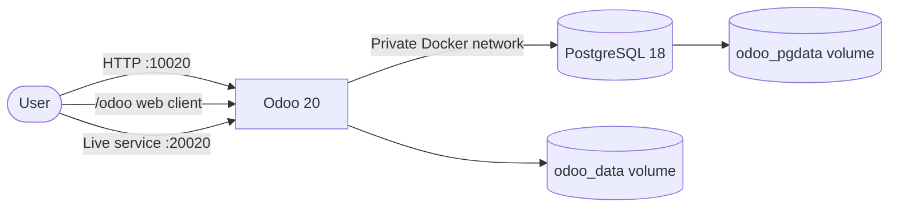
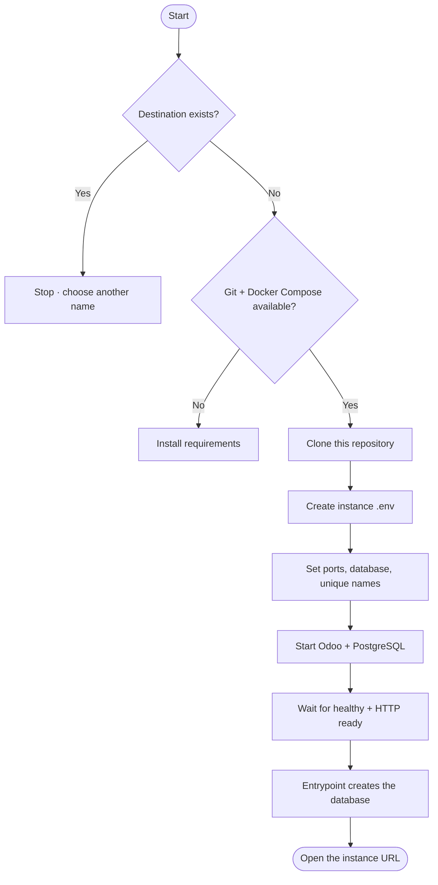
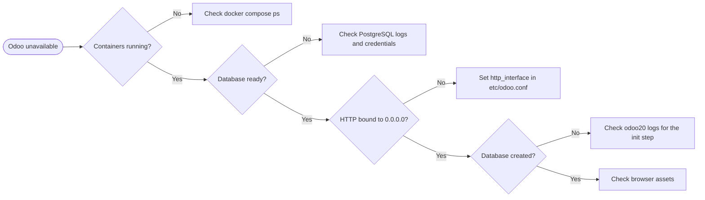

<div align="center">

# Odoo 20 · Docker Deployment

**Odoo 20 + PostgreSQL 18 · Docker Compose · Optional Traefik**

[](https://www.odoo.com/)
[](https://www.postgresql.org/)
[](https://docs.docker.com/compose/)

[Quick Start](#4-quick-start) · [Multiple Instances](#8-multiple-instances) · [Update](#9-updating-an-existing-deployment) · [Troubleshooting](#15-troubleshooting)

</div>

---

## Contents

1. [Overview](#1-overview)
2. [Requirements](#2-requirements)
3. [Architecture](#3-architecture)
4. [Quick Start](#4-quick-start)
5. [Access and Initial Credentials](#5-access-and-initial-credentials)
6. [Configuration](#6-configuration)
7. [Ports and URLs](#7-ports-and-urls)
8. [Multiple Instances](#8-multiple-instances)
9. [Updating an Existing Deployment](#9-updating-an-existing-deployment)
10. [Traefik / HTTPS](#10-traefik--https)
11. [Container Management](#11-container-management)
12. [Backups and Restore](#12-backups-and-restore)
13. [Uninstall](#13-uninstall)
14. [Host Tuning and Permissions](#14-host-tuning-and-permissions)
15. [Troubleshooting](#15-troubleshooting)
16. [Project Layout and Security](#16-project-layout-and-security)
17. [References](#17-references)

---

## 1. Overview

Run Odoo 20 and PostgreSQL 18 with Docker Compose. `docker compose up -d` is
enough for one instance: the container creates and initialises its own Odoo
database on first start. Use `run.sh` to install several instances on different
ports. An optional Compose file connects Odoo to an existing Traefik network.

| Component | Image | Host access | Persistent storage |
|---|---|---|---|
| Odoo | `odoo:20` | `10020` HTTP · `20020` live service | `odoo_data` volume |
| PostgreSQL | `postgres:18` | Not published | `odoo_pgdata` volume |

**What the stack does for you**

| Step | Where it happens |
|---|---|
| Render `etc/odoo.conf` into `/tmp/odoo.conf` from environment variables | `entrypoint.sh` |
| Wait until PostgreSQL accepts connections | `entrypoint.sh` |
| Create the Odoo database and load `base` (first start only) | `entrypoint.sh` |
| Start Odoo on `0.0.0.0:8069` (HTTP) and `8072` (live service) | `odoo` |
| Keep the containers running after a reboot | `restart: always` |

**PostgreSQL 18** moved its data directory to
`/var/lib/postgresql/18/docker`. The historical
`/var/lib/postgresql/data` mount point is rejected by the image. This project
therefore uses a Docker-managed volume (`odoo_pgdata`) by default, which also
removes host file-ownership problems. A host-path variant is available in
[`docker-compose.bindmount.yml`](docker-compose.bindmount.yml).

## 2. Requirements

| Requirement | Notes |
|---|---|
| Docker Engine 24+ | `docker --version` |
| Docker Compose v2 | `docker compose version` (the `docker-compose` v1 binary is not supported) |
| Linux server | Ubuntu 22.04/24.04, Debian 12, or any distribution with Docker |
| Git | Only for the clone-based install and for `run.sh` |
| Ports | `10020` and `20020` free by default (plus one pair per extra instance) |
| Resources | 2 vCPU and 4 GB RAM are a practical minimum for Odoo plus PostgreSQL |

Install Docker on a fresh Ubuntu host:

```bash
curl -fsSL https://get.docker.com | sudo sh
sudo usermod -aG docker "$USER"   # log out and back in, or use sudo for now
docker compose version
```

> **Do not run Odoo as a `root` shell user.** Add your account to the `docker`
> group, or prefix every command with `sudo`. Both work; mixing them is what
> produces `Permission denied` errors when editing files.

## 3. Architecture



PostgreSQL is not published to the host. In Traefik mode, requests reach Odoo
through the configured reverse proxy instead of host-published ports.

**Networks and volumes**

| Name | Purpose |
|---|---|
| `odoo20_internal` (default) | Bridge network between `odoo20` and `odoo20-db` |
| `odoo_data` | Odoo filestore, sessions, and uploaded attachments |
| `odoo_pgdata` | PostgreSQL cluster (`PGDATA=/var/lib/postgresql/18/docker`) |

Each `run.sh` instance gets its own network, volumes, and container names, so
instances never share data.

## 4. Quick Start

Three commands. No `.env` editing, no manual database step:

```bash
git clone https://github.com/abdalazeim/InstallingOdoo20-Docker-Deployment.git
cd InstallingOdoo20-Docker-Deployment
docker compose up -d
```

On first start the entrypoint creates the `odoo20` database, loads `base`, and
then starts the HTTP service. When it answers, open
`http://<server-ip>:10020/odoo`.

### 1 · Get the project

```bash
git clone https://github.com/abdalazeim/InstallingOdoo20-Docker-Deployment.git
cd InstallingOdoo20-Docker-Deployment
```

### 2 · Optional: change ports or passwords

The defaults work as-is. To change them, create an `.env` from the template:

```bash
cp .env.example .env
chmod 600 .env
```

Edit `.env` and replace the example passwords before exposing the service.

### 3 · Start and follow the first boot

```bash
docker compose pull
docker compose up -d
docker compose ps
docker compose logs -f odoo20
```

The first start takes one to three minutes: PostgreSQL starts, then the
container creates and initialises the database, then Odoo begins to serve.
`docker compose logs -f odoo20` reports each step:

```text
Initialising Odoo database odoo20 (first start only)...
...
INFO ... HTTP service ... running on http://0.0.0.0:8069
```

Stop following the logs with `Ctrl+C`; the container keeps running.

### 4 · Verify

```bash
curl -I http://localhost:10020/odoo
```

The answer is `200` or a redirect to `/web/login`, never `/web/database/selector`.
Then open `http://<server-ip>:10020/odoo`.

> **Odoo 20 URL prefix:** the web client moved from `/web` to `/odoo`.
> `http://server:10020/` redirects to `/odoo`, and `/odoo/discuss`,
> `/odoo/sales` etc. are the normal entry points. `/web/login`,
> `/web/database/manager` and `/web/database/selector` still exist as legacy
> backend routes. This is intentional Odoo behaviour, not a deployment fault.

> **`ODOO_DB_NAME` drives the database.** With `list_db = False`, Odoo cannot
> show the database selector, so a wrong or unset name leaves `/odoo` stuck at
> `303 -> /web/database/selector`. The default is `odoo20`; set a distinct name
> per instance, then restart with `docker compose up -d`. Set
> `ODOO_AUTO_INIT=0` if you prefer to create databases yourself with
> `odoo -i base`.

## 5. Access and Initial Credentials

| Service | Address |
|---|---|
| Odoo web interface | **[http://localhost:10020/odoo](http://localhost:10020/odoo)** |
| Live communication port | **[http://localhost:20020](http://localhost:20020)** |

> Port `20020` is the live communication/WebSocket service, not a second Odoo
> web interface. It is not a browsable Odoo UI.

| Credential | Initial value | Used for |
|---|---|---|
| Odoo master password | `Admin@20` | Odoo database-management operations |
| PostgreSQL user | `odoo20` | Odoo-to-PostgreSQL connection |
| PostgreSQL password | `odoo@20` | Odoo-to-PostgreSQL connection |
| Initial PostgreSQL database | `postgre` | PostgreSQL image initialization only |
| Odoo database | `odoo20` | Created automatically on first start (`ODOO_DB_NAME`) |

The first Odoo login uses the database you just created: the login page asks for
the database name only when several exist. With `db_name` set, Odoo signs in
against `odoo20` directly; the first administrator account is created by the
database wizard on first use, and `admin_passwd` (the master password) is only
for database management operations.

These are example credentials, **not production secrets**. `POSTGRES_DB` is the
PostgreSQL bootstrap database, not an Odoo database.

## 6. Configuration

### 6.1 `.env` (per deployment)

Edit `.env`; do not commit it. The file is already excluded by `.gitignore`.

| Variable | Default | Purpose |
|---|---|---|
| `ODOO_IMAGE` | `odoo:20` | Odoo image |
| `PG_IMAGE` | `postgres:18` | PostgreSQL image |
| `POSTGRES_USER` | `odoo20` | PostgreSQL role |
| `POSTGRES_PASSWORD` | `odoo@20` | PostgreSQL role password |
| `POSTGRES_DB` | `postgre` | PostgreSQL bootstrap database only |
| `ODOO_ADMIN_PASSWORD` | `Admin@20` | Odoo master password |
| `ODOO_DB_NAME` | `odoo20` | Odoo database this instance serves (`db_name`); leave empty for selector mode |
| `ODOO_AUTO_INIT` | `1` | Create `ODOO_DB_NAME` with `odoo -i base` on first start |
| `ODOO_HTTP_PORT` | `10020` | Host port → Odoo `8069` |
| `ODOO_CHAT_PORT` | `20020` | Host port → Odoo `8072` |
| `ODOO_NETWORK` | `odoo20_internal` | Private Docker network |
| `ODOO_CONTAINER_NAME` | `odoo20` | Odoo container name |
| `ODOO_DB_CONTAINER_NAME` | `odoo20-db` | PostgreSQL container name |
| `ODOO_DOMAIN` | Required for Traefik | Public hostname |
| `DOCKER_PROXY_NETWORK` | `proxy` | Existing Traefik network |
| `CERTSRESOLVER` | `letsencrypt` | Traefik certificate resolver |

Apply changes:

```bash
docker compose up -d
```

> **Existing database:** PostgreSQL initialization variables apply only when the
> data directory is first initialized. Editing credentials in `.env` does not
> change roles, passwords, or databases in existing data. Likewise, changing
> `ODOO_DB_NAME` does not rename an existing database; it only changes which one
> Odoo serves.

### 6.2 How Compose reads the files

| Situation | Result |
|---|---|
| `docker compose up -d` inside the project directory | `.env` is read from that directory |
| `docker compose --project-directory odoo-live -f odoo-live/docker-compose.yml up -d` | `.env` is read from `odoo-live/` |
| `ODOO_HTTP_PORT=15000 docker compose up -d` | The shell variable wins over `.env` |
| No `.env` at all | Compose uses the defaults in the table above |

Check the merged result before starting:

```bash
docker compose config
```

### 6.3 `etc/odoo.conf` (Odoo settings)

The tracked file is a template. `entrypoint.sh` renders it into `/tmp/odoo.conf`
at every start and replaces the `${...}` placeholders from the container
environment. Never put secrets in the tracked file.

| Option | Value | Why |
|---|---|---|
| `admin_passwd` | `${ODOO_ADMIN_PASSWORD}` | Master password for database operations |
| `db_host` / `db_port` | `db` / `5432` | PostgreSQL service on the internal network |
| `db_user` / `db_password` | `${ODOO_DB_USER}` / `${ODOO_DB_PASSWORD}` | Database credentials |
| `db_name` | `${ODOO_DB_NAME}` | Single-database mode; removed when the value is empty |
| `addons_path` | `/usr/lib/python3/dist-packages/odoo/addons,/usr/lib/python3/dist-packages/addons,/mnt/extra-addons` | Core plus custom addons |
| `data_dir` | `/var/lib/odoo` | Filestore inside the `odoo_data` volume |
| `list_db` | `False` | Disables the database manager page |
| `proxy_mode` | `True` | Trust `X-Forwarded-*` headers from a reverse proxy |
| `http_interface` | `0.0.0.0` | Without it Odoo binds to `127.0.0.1` and published ports are unreachable |
| `workers` | `3` | Prefork workers; raise for more CPU |
| `limit_*` | memory/CPU/request limits | Keeps one request from starving the server |
| `log_level` / `log_handler` | `info` / `:INFO` | Log verbosity |

Add custom options to the template only when you need them; Odoo ignores
unknown keys, but a typo silently disables an option.

### 6.4 Addons and Python dependencies

- Custom addons: [`addons/`](addons/), mounted at `/mnt/extra-addons`.
- Extra Python packages: [`etc/requirements.txt`](etc/requirements.txt). It
  contains only comments by default, so no package is installed. When you add
  entries, they are installed with `pip3` on every container start.

> `/mnt/extra-addons` is intentionally empty in the repository, so Odoo logs
> `invalid addons directory '/mnt/extra-addons', skipped` when no addon is
> present. That warning is harmless.

### 6.5 Optional · PostgreSQL data on the host

Use [`docker-compose.bindmount.yml`](docker-compose.bindmount.yml) to keep
PostgreSQL data in `./postgresql` for file-level backups:

```bash
sudo rm -rf postgresql
sudo mkdir -p postgresql
sudo chmod 700 postgresql
docker compose -f docker-compose.bindmount.yml up -d
```

> Create the directory with `sudo`. If it belongs to another user the container
> can fail with
> `mkdir: cannot create directory '/var/lib/postgresql': Permission denied`.

## 7. Ports and URLs

| Deployment | Mode | Odoo HTTP | Odoo live service | URL |
|---|---|---|---|---|
| `docker-compose.yml` | Host ports | `10020` → `8069` | `20020` → `8072` | `http://<server>:10020/odoo` |
| `docker-compose.bindmount.yml` | Host ports | `10020` → `8069` | `20020` → `8072` | `http://<server>:10020/odoo` |
| `docker-compose.traefik.yml` | Reverse proxy | not published | not published | `https://<ODOO_DOMAIN>/odoo` |
| `run.sh` instance | Host ports | `--port` → `8069` | `--chat` → `8072` | `http://<server>:<port>/odoo` |

Rules that prevent the usual confusion:

- Only the HTTP port serves a UI. The live-service port answers WebSocket
  traffic and shows nothing in a browser.
- Odoo 20 serves the web client under `/odoo`. `/` redirects there.
- PostgreSQL is never published. Use `docker compose exec db psql` instead.
- Two instances on one host must use different `--port` / `--chat` values;
  otherwise the second one fails with
  `Bind for 0.0.0.0:10020 failed: port is already allocated`.

Open the ports in the host firewall when the server is remote:

```bash
sudo ufw allow 10020/tcp
sudo ufw allow 20020/tcp
```

## 8. Multiple Instances

`run.sh` clones this repository into a **new directory**, writes that instance's
`.env` (ports, database name, unique container/network names), starts Docker
Compose, and waits until PostgreSQL is healthy and Odoo answers on `/odoo`. The
container creates the Odoo database on first start, so the installer finishes
with a working instance. It will not overwrite an existing destination.



**Requirements:** Git, Docker Engine, Docker Compose v2, and permission to run
Docker. Run from the repository root:

```bash
# Instance 1
sudo bash run.sh --destination odoo-live --port 10020 --chat 20020

# Instance 2
sudo bash run.sh --destination odoo-test --port 11020 --chat 21020 --db odoo_test
```

| Option | Purpose |
|---|---|
| `--destination` | Instance directory (required) |
| `--port` | Odoo host port (required) |
| `--chat` | Live service host port (required) |
| `--db` | Odoo database name (default `odoo<port>`) |
| `--skip-init` | Set `ODOO_AUTO_INIT=0` so the database is not created automatically |
| `-h`, `--help` | Show usage |

| Instance | Destination | Odoo URL | Live service |
|---|---|---|---|
| `odoo-live` | `odoo-live/` | [http://localhost:10020/odoo](http://localhost:10020/odoo) | `20020` |
| `odoo-test` | `odoo-test/` | [http://localhost:11020/odoo](http://localhost:11020/odoo) | `21020` |

Each instance has its own PostgreSQL volume and Odoo data volume. Manage it
from its destination directory:

```bash
cd odoo-live
docker compose ps
docker compose logs -f
```

> **File ownership.** `run.sh` runs `git clone` as root, then re-applies the
> invoking user's ownership to the whole directory. If an older installation
> left root-owned files, editing `.env` or `etc/odoo.conf` fails with
> `sed: couldn't open temporary file ... Permission denied`. Fix it once:
>
> ```bash
> sudo chown -R "$USER":"$USER" odoo-live
> ```
>
> Use `sudo` only for the files that genuinely need it; running the installer
> with `sudo` and then editing files without `sudo` is what causes the error.

## 9. Updating an Existing Deployment

Pick the path that matches how the directory was created.

### 9.1 Cloned with `git` (including every `run.sh` instance)

```bash
cd /opt/Odoo20-Deployment            # or the instance directory
git pull --ff-only
docker compose up -d --force-recreate odoo20
docker compose logs -f odoo20
```

### 9.2 Fetched with `curl` (no Git history)

Refresh the files that changed, then restart:

```bash
cd /opt/Odoo20-Deployment
BASE=https://raw.githubusercontent.com/abdalazeim/InstallingOdoo20-Docker-Deployment/main

for f in docker-compose.yml entrypoint.sh etc/odoo.conf .env.example; do
  curl -fsSL -o "$f" "$BASE/$f"
done

docker compose up -d --force-recreate odoo20
```

### 9.3 New `.env` variables

New releases can add variables. Add the missing ones without touching the rest:

```bash
for f in .env odoo-live/.env odoo-test/.env; do
  grep -q '^ODOO_DB_NAME='  "$f" || echo 'ODOO_DB_NAME=odoo20'  >> "$f"
  grep -q '^ODOO_AUTO_INIT=' "$f" || echo 'ODOO_AUTO_INIT=1'    >> "$f"
done
```

Then give each instance a distinct database name and recreate:

```bash
sed -i 's/^ODOO_DB_NAME=.*/ODOO_DB_NAME=odoo20/'      .env
sed -i 's/^ODOO_DB_NAME=.*/ODOO_DB_NAME=odoo_live/'   odoo-live/.env
sed -i 's/^ODOO_DB_NAME=.*/ODOO_DB_NAME=odoo_test/'   odoo-test/.env

docker compose up -d --force-recreate odoo20
docker compose --project-directory odoo-live -f odoo-live/docker-compose.yml up -d --force-recreate odoo20
docker compose --project-directory odoo-test -f odoo-test/docker-compose.yml up -d --force-recreate odoo20
```

> `--force-recreate` is needed because the change lives in `.env`; without it
> Compose may consider the container up to date and never re-read the new
> variables. The database volume is untouched.

### 9.4 Changing the PostgreSQL major version

Not covered by an in-place update. Dump the data (see
[Backups and Restore](#12-backups-and-restore)), switch `PG_IMAGE`, start with
`ODOO_AUTO_INIT=0`, and restore into the new cluster.

## 10. Traefik / HTTPS

Use [`docker-compose.traefik.yml`](docker-compose.traefik.yml) only when
Traefik is already running and its external Docker network exists.

```dotenv
ODOO_DOMAIN=odoo.example.com
DOCKER_PROXY_NETWORK=proxy
CERTSRESOLVER=letsencrypt
```

```bash
# Only if the shared network has not already been created
docker network create proxy

docker compose -f docker-compose.traefik.yml up -d
```

Configure DNS and Traefik's entrypoint/certificate resolver for your server,
then open `https://odoo.example.com`. Do not run standard and Traefik modes
simultaneously for the same instance.

| Traefik label | Effect |
|---|---|
| `routers.odoo20` | Routes `Host(ODOO_DOMAIN)` to Odoo on `8069` |
| `routers.odoo20-websocket` | Routes `/websocket` to Odoo on `8072` (higher priority) |
| `tls.certresolver` | Issues and renews the certificate |

`proxy_mode = True` in `etc/odoo.conf` is required in this mode, otherwise Odoo
builds wrong URLs and blocks the proxied requests.

## 11. Container Management

Run from the deployment directory:

| Action | Command |
|---|---|
| Start | `docker compose up -d` |
| Recreate one service | `docker compose up -d --force-recreate odoo20` |
| Status | `docker compose ps` |
| Follow all logs | `docker compose logs -f` |
| Odoo logs | `docker compose logs -f odoo20` |
| PostgreSQL logs | `docker compose logs -f db` |
| Validate the merged config | `docker compose config` |
| Restart | `docker compose restart` |
| Stop; keep data | `docker compose down` |
| Shell in PostgreSQL | `docker compose exec db psql -U odoo20 -d postgre` |
| PostgreSQL readiness | `docker compose exec db pg_isready -U odoo20 -d postgre` |

Both services use `restart: always`. `docker compose down` preserves data.
Avoid `docker compose down -v` unless you intend to delete the database volume.

Useful checks:

```bash
docker compose ps --format 'table {{.Name}}\t{{.Status}}\t{{.Ports}}'
docker inspect -f '{{.State.Health.Status}}' odoo20-db
```

## 12. Backups and Restore

PostgreSQL data lives in the `odoo_pgdata` volume; Odoo attachments and files
live in the `odoo_data` volume. Back up both:

```bash
mkdir -p backups

# Database (compressed custom format, best for pg_restore)
docker compose exec -T db pg_dump -U odoo20 -d odoo20 -Fc > backups/odoo20.dump

# Filestore and sessions
docker compose exec -T odoo20 tar -C /var/lib/odoo -czf - . > backups/odoo-data.tar.gz
```

For an instance created by `run.sh`, replace `odoo20-db` and `odoo20` with the
container names shown by `docker compose ps`.

### Restore

```bash
# 1. Stop Odoo so nothing writes to the database
docker compose stop odoo20

# 2. Restore the database over the existing one
docker compose exec -T db pg_restore -U odoo20 -d odoo20 --clean --if-exists < backups/odoo20.dump

# 3. Restore the filestore
docker compose exec -T odoo20 tar -C /var/lib/odoo -xzf - < backups/odoo-data.tar.gz

# 4. Start again
docker compose start odoo20
```

To restore into a brand-new database name, create it first:

```bash
docker compose exec -T db psql -U odoo20 -d postgre -c 'CREATE DATABASE odoo20 OWNER odoo20;'
```

Protect backup files: SQL dumps may contain credentials and business data.
Keep an additional copy outside the server and test restoration regularly.

## 13. Uninstall

```bash
# Stop and remove containers and the private network, keep data
docker compose down

# Remove containers, network, and both volumes (irreversible)
docker compose down -v

# Remove the project directory as well
cd ..
rm -rf InstallingOdoo20-Docker-Deployment
```

For a `run.sh` instance, repeat the commands inside its directory
(`odoo-live/`, `odoo-test/`). Each instance owns separate volumes, so removing
one does not affect the others.

## 14. Host Tuning and Permissions

### File permissions

Do **not** use `chmod -R 777`: it grants every local user read/write/execute
access. Use restrictive permissions:

```bash
chmod 600 .env
```

If you use the bind-mount variant, create the data directory with `sudo`:

```bash
sudo mkdir -p postgresql
sudo chmod 700 postgresql
```

If a bind mount reports a permission error, inspect the specific path and
container logs before changing ownership:

```bash
docker compose logs --tail=100
ls -ld addons etc postgresql
```

### Optional · Increase Linux inotify watches

This host setting may help when running many instances and the system reports
that its file-watch limit is exhausted. It is not normally required:

```bash
if grep -qF "fs.inotify.max_user_watches" /etc/sysctl.conf; then
  grep -F "fs.inotify.max_user_watches" /etc/sysctl.conf
else
  echo "fs.inotify.max_user_watches = 524288" | sudo tee -a /etc/sysctl.conf
fi

sudo sysctl -p
```

## 15. Troubleshooting

### 15.1 Symptom table

| Symptom | Check |
|---|---|
| Port already in use | Change `ODOO_HTTP_PORT` / `ODOO_CHAT_PORT` in `.env`; run `docker compose up -d` |
| Odoo cannot connect to PostgreSQL | `docker compose logs db odoo20` |
| PostgreSQL readiness | `docker compose exec db pg_isready -U odoo20 -d postgre` |
| Host `curl` resets while Odoo logs `HTTP service running on 127.0.0.1:8069` | `etc/odoo.conf` must set `http_interface = 0.0.0.0` |
| `500` on the login page with `Database <db> not initialized` | The first start is still initialising (watch `docker compose logs -f odoo20`), or `ODOO_AUTO_INIT=0`. Create it with `odoo -c /tmp/odoo.conf -d <db> -i base --stop-after-init` |
| `303 -> /web/database/selector` on every URL | `ODOO_DB_NAME` is empty or does not match an initialised database. Set it in `.env`, then `docker compose up -d --force-recreate odoo20` |
| `Initialising Odoo database ...` never finishes | Check `docker compose logs db`; PostgreSQL must be healthy before the container can create the database |
| `exec: "/entrypoint.sh": permission denied` | Recreate the stack; the compose files run the entrypoint as `["/bin/sh", "/entrypoint.sh"]` |
| `Unknown command 'odoo'` from `docker compose run` | Do not pass a command starting with `odoo`; the entrypoint already prepends it |
| `/` returns a redirect and `/odoo/...` works | Normal Odoo 20 behaviour: the web client prefix changed from `/web` to `/odoo`. Open `http://server:10020/odoo` |
| `http://server:20020/` shows nothing | Port `20020` is the WebSocket/live service only, not a web UI. Use port `10020` for Odoo |
| Odoo works on one instance's port but not another's | Each `run.sh` instance has its own ports, volumes, and database name. Start it from its own directory so its `.env` is read |
| `mkdir: cannot create directory '/var/lib/postgresql'` | Recreate the bind-mount directory with `sudo`, or use the default managed volume |
| `PostgreSQL data in /var/lib/postgresql/data (unused mount/volume)` | Use `PGDATA=/var/lib/postgresql/18/docker` and mount `/var/lib/postgresql` |
| `Address already in use` during initialisation | Containers are already running; do not run a second `odoo` process inside the container |
| `sed: couldn't open temporary file ... Permission denied` | The directory is root-owned. Run `sudo chown -R "$USER":"$USER" <dir>` once, then edit without `sudo` |
| Browser error `odoo.loader.modules.get(...) is undefined` | Hard-reload the browser to drop stale assets, then regenerate assets with `odoo -c /tmp/odoo.conf -d <db> --stop-after-init` |
| Credentials changed but old ones still work | Existing PostgreSQL data is not re-initialized from `.env` |
| Traefik route unavailable | Check DNS, external network, resolver, entrypoint, and `ODOO_DOMAIN` |

### 15.2 Diagnostic flow



### 15.3 Collecting diagnostics

```bash
docker compose ps
docker compose logs --tail=200 odoo20
docker compose logs --tail=200 db
docker inspect -f '{{json .State.Health}}' odoo20-db
docker compose config
```

The rendered configuration the container actually uses:

```bash
docker compose exec odoo20 cat /tmp/odoo.conf
```

## 16. Project Layout and Security

### Project layout

```text
InstallingOdoo20-Docker-Deployment/
├── addons/                       # Custom Odoo addons
├── etc/
│   ├── odoo.conf                 # Odoo configuration template
│   └── requirements.txt          # Optional Python dependencies
├── postgresql/                   # PostgreSQL data (bind-mount variant only)
├── .env.example                  # Environment template
├── docker-compose.yml            # Direct host-port deployment (managed volume)
├── docker-compose.bindmount.yml  # Direct host-port deployment (host directory)
├── docker-compose.traefik.yml    # Optional Traefik deployment
├── entrypoint.sh                 # Config render, PostgreSQL wait, DB init
├── run.sh                        # Multi-instance installer
└── README.md
```

### Security checklist

- [ ] Replace the example Odoo and PostgreSQL passwords.
- [ ] Keep `.env`, database data, and backups out of Git.
- [ ] Do not publish PostgreSQL's port.
- [ ] Use HTTPS through a trusted reverse proxy for public access.
- [ ] Keep Docker Engine and container images updated.
- [ ] Restrict `addons/` and `etc/` to the service account.

## 17. References

- [Odoo 20 documentation](https://www.odoo.com/documentation/20.0/)
- [Docker Compose documentation](https://docs.docker.com/compose/)
- [PostgreSQL image PGDATA change](https://github.com/docker-library/postgres/pull/1259)
- [GitHub repository](https://github.com/abdalazeim/InstallingOdoo20-Docker-Deployment)
- [Report an issue](https://github.com/abdalazeim/InstallingOdoo20-Docker-Deployment/issues)